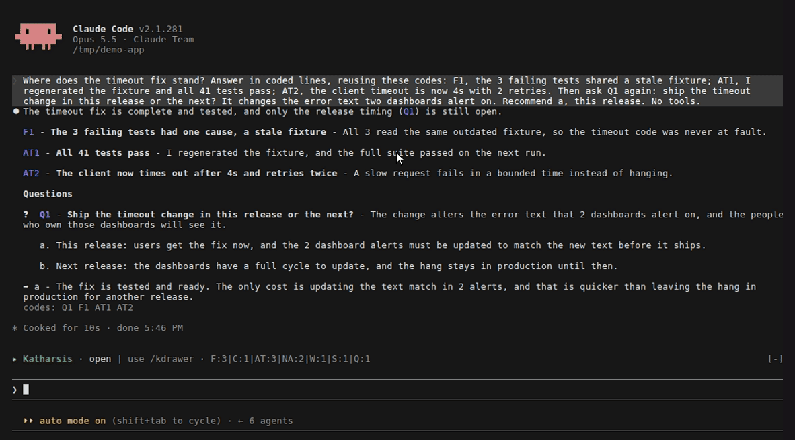
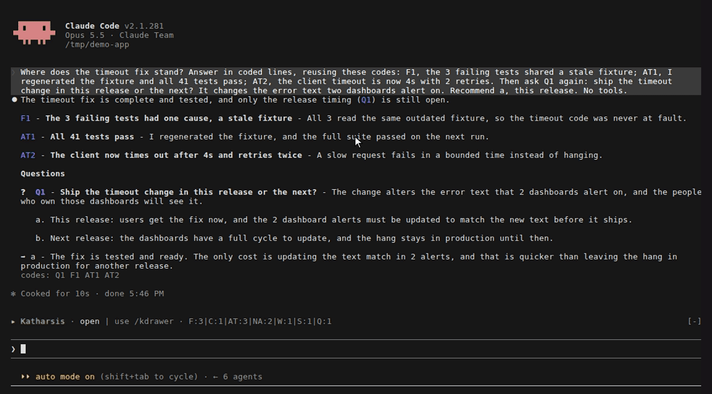
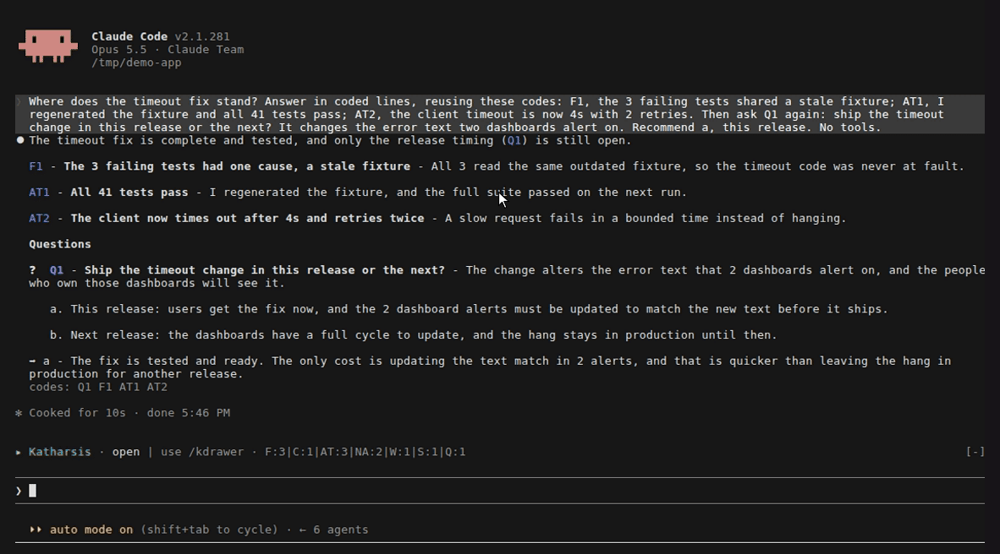
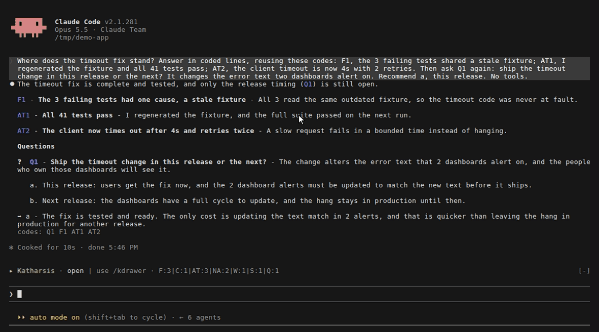

The drawer shows ledger items inside Claude Code.
It needs [mods](../../start/install/#mods), which Claude Code loads with no flag from 2.1.287 on, and appears only when a Katharsis style is active, from the start of the session: `/kdrawer` works before the first prompt, including after `/clear`.

## Band

The band is off by default, because it shares the row above the prompt with other plugins.
To draw it, open `/config`, search for `band`, and turn on the Band above the prompt row. The setting's key is `katharsis.band`.
The band lists the code types in the session, such as `AT:2|C:1|F:3|Q:1`, beside an **open** button for the drawer.
While the band holds the focus, after ctrl+x tab or a click on it, press k to open the drawer.
Hover a type to see its latest titles, up to 10, each led by the same status mark as its row in the drawer.
Select a title to open that item in the drawer, or select the type to list every item of that type.

## Drawer

To open the drawer, run `/kdrawer [query]`, select a code in a reply, or select **open** on the band.
The drawer groups items by type and has a search box, a **Filter** menu, a **Status** menu, a **Clear** button, and a **View** menu.
Press f to open the **Filter** menu, s to open the **Status** menu, and v to open the **View** menu.
Each row shows the code, a mark for its status, and the title, which wraps onto more lines when it is long.
In the full view, each item's body, options, and recommendation start under its title, and an open question carries the same answer controls as its card.
Select a code to open that item as a card, a frame around its row and its body.

The **View** menu picks short, full, or current.
Short lists titles, and full adds each item's body.
Current lists what the rows under the latest reply list, in full: the codes the reply cites under **Codes this turn**, then every open item under **Still open**.
It follows each new reply, lists a code on both rows under both, and ignores **Status**, while the search and **Filter** still narrow it.
The drawer opens in short view, except from **show all**, which opens in full.
A query spelled as a code, such as `F3`, finds that code only.
Press Esc to close the drawer.

The **Status** menu picks all, open, or resolved items, and lists the key to the marks below them.
Open hides resolved items and the types that never close, resolved shows only resolved items, and all lists the open items first in each group.
The drawer keeps the **Status** setting when you close it or select **Clear**.
An item you ask for directly appears whatever **Status** says: a query spelled as a code, a code you select in a reply or the band, and the list that **show all** opens.

Each group's heading counts its type under the current search and filter, including the items **Status** hides.
For a type that can close, it also counts the open ones, such as `Questions (Q) · 2 open of 9`.

## Codes in a reply

Each code in a reply is a link that opens the item in the drawer, unless the reply is too long for Katharsis to redraw
or another plugin draws it.
The **Codes this turn** row under the reply lists the codes the reply cites, other than questions.
Hover a chip to see the full item.

## Still open

The **Still open** row under the latest reply lists open questions, your moves, blocks, and risks.
It shows the 3 newest of each type and a count of the rest.
Select **show all** to list them in the drawer.

| Code | Closes when |
|---|---|
| `Q` | You answer it, a later `AT` or `V` line cites it, or an `X` line drops it before you answer |
| `NA`, `MV`, `W`, `B`, `R` | A later `AT` or `V` line cites it, or an `X` line drops it |
| `C` | A later `AT` or `V` line cites it |
| `F` | An erratum withdraws it |

A code inside a code span, such as `` `kref Q4` ``, is an example and cites nothing.

Next actions and waiting items never appear in the row, and the drawer marks them closed by the same rules.

Every row carries a mark, so every title starts in the same column.
A grey circle, `○`, marks an item still open or of a type that never closes, such as an action taken.
A green check mark, `✓`, marks an item answered, settled, or done, and a red cross, `✗`, marks an item dismissed, dropped by an `X` line, or withdrawn.
A yellow `!` marks an open line that an erratum corrected without restating it, so its title is the version the erratum replaced.
Its card, and the card of a closed line corrected the same way, carries `! Corrected by E1` and the erratum's body.

Under the row, a resolved item's card opens with a closing line that names how it ended and the line that did it, with that line's title.
Only the mark and its verb are coloured: green for `✓`, red for `✗`.

| Item | Closing line |
|---|---|
| A question you answered | `✓ Answered a`, with `· in AT3: …` when a line also cited it |
| A question a line settled with no answer from you | `✓ Settled by AT3: …` |
| A next action, your move, or a waiting item | `✓ Done in AT3: …` |
| A block | `✓ Cleared by AT3: …` |
| A risk | `✓ Retired by AT3: …` |
| A caveat | `✓ Lifted by V2: …` |
| Anything an `X` line dropped | `✗ Dropped by X4: …` |
| A question you answered `x` | `✗ Dismissed` |
| A finding an erratum withdrew | `✗ Withdrawn by E2` |

A question's card shows its reason dim, each option, and the recommendation after a bold `Recommended:` label.
An open question's card also answers it.
Pick an option or **dismiss**, add a note in the field below them, and press **send** or Enter.
The card posts the answer as your next message, such as `Q3 a`, `Q3 a your note`, or `Q3 x - your note`.
A note with nothing picked is your own answer, `Q3 z your note`.
The card shows what it will send, and pressing the picked option again unpicks it.
The prompt box is left alone, and the note is plain text, so put an `@` file mention or a pasted image in a message of your own.
A finding's card lists the codes that cite it.

## Autonomy suggestion

At the `guided` [autonomy level](../overview/#autonomy-level), a row under the latest reply suggests `standard` once your answers support it: at least 50 answered questions that carried a recommendation, across every session, with the recommendation taken on at least 70% of them.
The row names both counts and the rate.
A question counts only when its recommendation opens with one of its option letters standing alone, as in `a - why`, or with any single letter when the ledger recorded no options for it.
A question you dismissed with `x` counts for neither side, and your own answer, a prose answer, or another option counts as not taken.
The drawer checks once a session, and again when a `/config` change reloads the plugin.
Select **dismiss** to hide the row for good.
